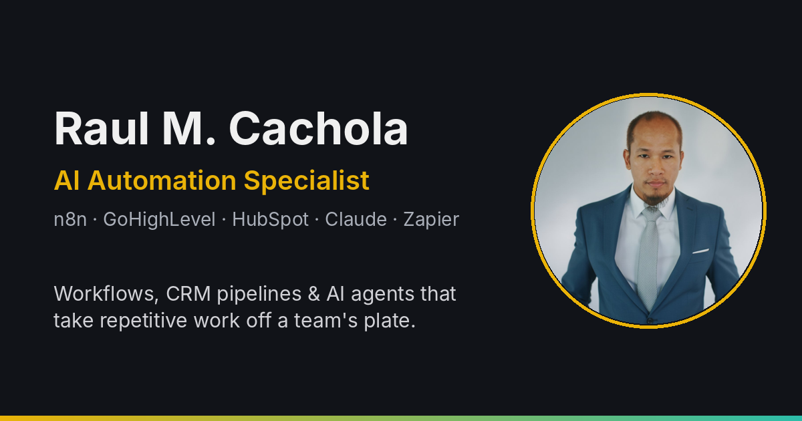
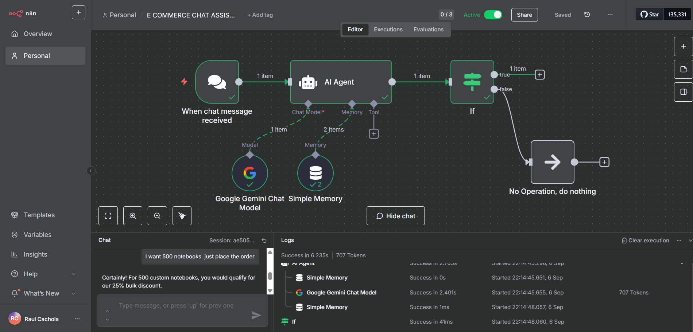
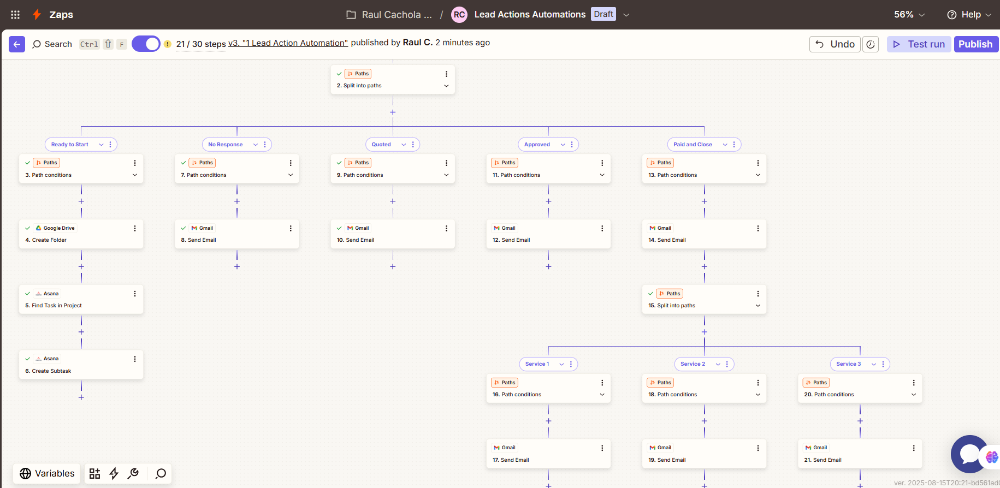
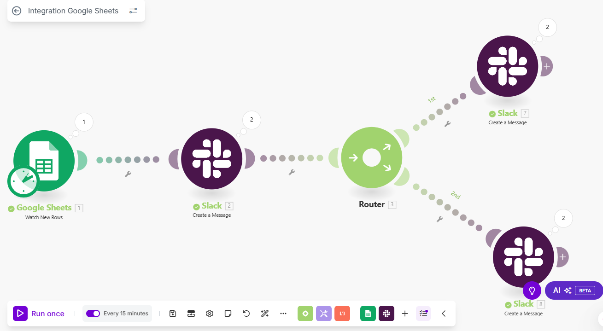

# Raul M. Cachola — AI Automation Portfolio



**LinkedIn:** [linkedin.com/in/raulcachola](https://www.linkedin.com/in/raulcachola/) · **Upwork:** [profile](https://www.upwork.com/freelancers/~01e9036c554823230c)

I'm an AI Automation Specialist based in the Philippines. I build workflows in n8n, Zapier and Make, set up GoHighLevel and HubSpot CRM pipelines, and build AI agents that take repetitive work off a team's plate. Before automation I spent three years as a Technical Web Advisor at Concentrix (HostGator account), handling DNS, hosting, email and WordPress issues. That's where I learned to debug calmly and document everything.

This repo is the source code of my portfolio website.

## Workflows I've built

### E-commerce AI chat assistant (n8n + Google Gemini)
A chat agent that answers customer questions, takes bulk orders, applies the right discount and remembers the conversation. Below, it's handling a 500-notebook order and applying the 25% bulk discount.



### Lead action automation (Zapier, 30 steps)
Routes each lead down one of five paths (Ready to Start, No Response, Quoted, Approved, Paid and Close). Each path sends the right Gmail follow-up, and the Ready to Start path also creates the Google Drive folder and Asana tasks for the new project.



### Team notifications from Google Sheets (Make)
Watches a Google Sheet every 15 minutes and uses a router to send each update to the right Slack channel.



### More projects

| Project | What it does | Stack |
|---|---|---|
| **AI appointment setter** | AI voice agent calls customers to confirm bookings and cut no-shows | n8n, Retell |
| **Two-way SMS integration** | Automated SMS conversations and lead qualification, synced back into the CRM | n8n, GoHighLevel, Telekom API |
| **Lead capture + instant follow-up** | Captures form submissions and fires immediate SMS, email and task follow-ups | GoHighLevel |
| **HubSpot contact automation** | Enriches contacts, scores leads and triggers workflows from interaction data | n8n, HubSpot |
| **This site's contact form** | Posts every enquiry to my own n8n webhook for lead intake | React, n8n |

I've also completed **8 NextWork projects on Claude Code and AI**, including Claude Code setup, skills, safety guardrails, an AI second brain, and prompt engineering for healthcare and research.

## Tools I work with

- **Automation:** n8n · Zapier · Make
- **CRM:** GoHighLevel · HubSpot
- **AI:** Claude / Claude Code · Google Gemini · Retell
- **Web & infra:** WordPress · DNS, hosting & email setup · Supabase · AWS (studying for Cloud Practitioner)

## About this site

Built with React, TypeScript, Vite, Tailwind CSS and shadcn/ui. I started it in Lovable and customized it from there. To run it locally:

```sh
git clone https://github.com/rmctech-ai/raul-automates-it.git
cd raul-automates-it
npm install
npm run dev
```

## Contact

I'm open to automation projects and internship opportunities. The fastest way to reach me is [LinkedIn](https://www.linkedin.com/in/raulcachola/).
